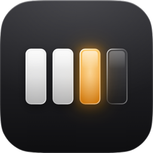
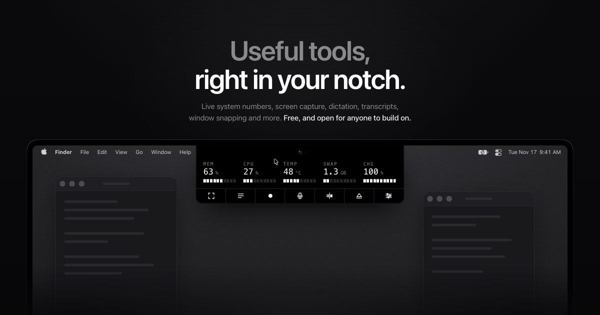
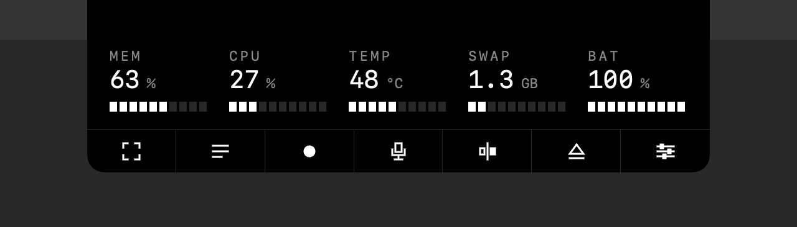
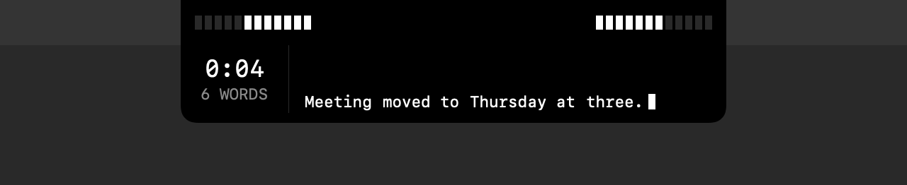
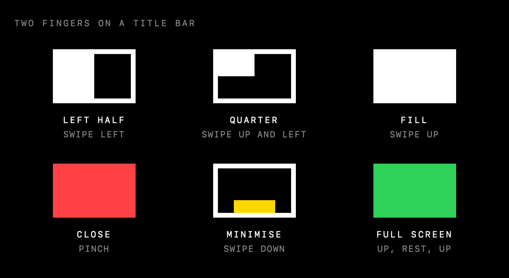
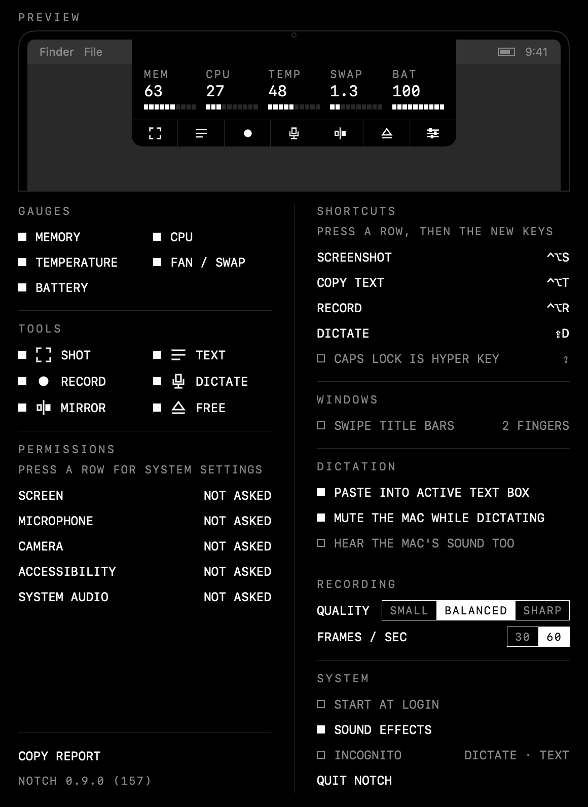

<div align="center">



<h1>Notch</h1>

<p><b>Useful tools, right in your MacBook's notch.</b><br>
Live system numbers, screen capture, dictation, window snapping, a hyper key, a mirror and transcripts.<br>
Free, open source, and nothing leaves your Mac.</p>

<a href="https://whatdoesthefoxsay2u.github.io/notch/"></a>

<a href="https://github.com/WHATDOESTHEFOXSAY2U/notch/releases/latest/download/Notch.dmg"></a>

<sub>Apple silicon · macOS 26 or later · 3.6 MB · no network code · MIT</sub>

<br><br>

<a href="https://whatdoesthefoxsay2u.github.io/notch/"></a>

</div>

<br>

## Start here

1. **[Visit the website](https://whatdoesthefoxsay2u.github.io/notch/)**: every tool, moving, in your browser. Nothing to install.
2. **[Download Notch.dmg](https://github.com/WHATDOESTHEFOXSAY2U/notch/releases/latest/download/Notch.dmg)**, or paste this one line into Terminal. It
   installs Notch into Applications and opens it, with no warning from macOS:

   ```sh
   curl -fsSL https://raw.githubusercontent.com/WHATDOESTHEFOXSAY2U/notch/main/install.sh | sh
   ```

3. Move the pointer up into the notch. The panel opens; move away and it closes. Each tool asks for its permission the
   first time you use it.

## Seven segments

| Segment | What you get |
|---|---|
| **[Numbers](https://whatdoesthefoxsay2u.github.io/notch/#numbers)** | Memory, CPU, temperature, fan or swap, and battery at a glance. FREE force-quits what hogs memory. |
| **[Capture](https://whatdoesthefoxsay2u.github.io/notch/#capture)** | A screenshot, the text off any part of the screen, or a recording with camera, voice and clicks. |
| **[Dictation](https://whatdoesthefoxsay2u.github.io/notch/#dictation)** | Talk, and it types into the text box you are in. Apple's speech engine, on your Mac. |
| **[Windows](https://whatdoesthefoxsay2u.github.io/notch/#windows)** | Two fingers on a title bar: halves, quarters, fill, minimise, full screen. |
| **[Keys](https://whatdoesthefoxsay2u.github.io/notch/#keys)** | Caps Lock becomes a hyper key, so every Caps Lock shortcut is yours. |
| **[Mirror](https://whatdoesthefoxsay2u.github.io/notch/#mirror)** | Your camera in the notch, flipped like a mirror, before the call starts. |
| **[Transcribe](https://whatdoesthefoxsay2u.github.io/notch/#transcribe)** | Drop a video, a sound file or a link on the notch and get every word, with speakers named. |

Want an eighth? [Build one](https://whatdoesthefoxsay2u.github.io/notch/#next): the code is small, plain Swift, and [MIT](LICENSE).

## Everything else

[What it does](#what-it-does) · [Requirements](#requirements) · [Install](#install) ·
[Build from source](#build-from-source) · [Permissions](#permissions) · [Privacy](#privacy) · [Settings](#settings) ·
[Uninstall](#uninstall) · [FAQ](#faq) · [Contributing](#contributing) · [License](#license)



It is one small app, about 3.6 MB, with no outside code.

## What it does

- **Gauges.** MEM, CPU, TEMP, FAN and BAT. FAN becomes SWAP while no fan spins. A gauge turns amber, then red, when it
  needs a look. With the panel closed, a short line in that colour shows under the notch.
- **SHOT.** Drag over part of the screen. The picture goes on your Desktop and on the clipboard. A card shows it for
  six seconds: COPY, SHOW in Finder, or × to move it to the Trash.
- **TEXT.** Drag over any text on the screen, even text you cannot select. It is read on your Mac and copied, with its
  line breaks and indents.
- **REC.** Drag over part of the screen and record it. Add your camera (CAM), your voice (MIC), what the Mac plays
  (SOUND) and your clicks (CLICKS). Pause when you like. The file goes on your Desktop. COMPRESS makes a smaller copy
  for sending.
- **DICTATE.** Talk, and your words appear under the notch. Stop with the same key, or click the strip. The text goes
  into the text box you are in, and onto the clipboard. While you talk, the Mac's sound is off, so the microphone hears
  only you. Or switch on HEAR THE MAC'S SOUND TOO, and what the Mac plays is written down as well: the other side of a
  call, a video.
- **TRANSCRIBE.** Writes down what is said in a video or a sound file. Press it, then PASTE LINK for the link on your
  clipboard, or CHOOSE FILE for one of your newest recordings. Or drag a video, a sound file or a link onto the notch.
  A channel or a playlist asks how many to take. The notch shows how far it is; point at it for STOP TRANSCRIBING. The
  text is saved as a file, each speaker named while SPEAKERS is on, and a card offers COPY, OPEN and SHOW. The work is
  done on your Mac by [Scribe](https://github.com/WHATDOESTHEFOXSAY2U/scribe), a separate app.
- **MIRROR.** Your camera, flipped like a mirror, inside the panel. The camera is on only while the mirror shows.
- **FREE.** The four apps using the most memory, their helpers included. Press one to force-quit it. Unsaved work in
  that app is lost.
- **CAPS LOCK IS HYPER KEY.** Hold Caps Lock with another key, and it counts as Control, Option, Shift and Command at
  once. No app uses that combination, so every Caps Lock shortcut is yours. Off at first.
- **SWIPE TITLE BARS.** Two fingers on a window's title bar: left or right for half the screen, diagonally for a
  quarter, up to fill it, down to minimise. Rest, then up again, for full screen. Pinch to close. A small picture
  follows your fingers, and the trackpad knocks as the choice changes. Off at first.
- **INCOGNITO.** DICTATE and TEXT work without showing or playing anything, and their text leaves the clipboard soon
  after. Off at first.
- **Shortcuts.** ⌃⌥S for SHOT, ⌃⌥T for TEXT, ⌃⌥R for REC, and ⌃⌥⇧⌘D for DICTATE, which is Caps Lock-D with the hyper
  key. They work in any app. Change them in Settings.





Notch has no Dock icon and no menu-bar icon. SET, the last key in the panel, opens Settings, and so does opening the
app again. A short line under the notch says what happened (COPIED 120 CHARS) or what is needed (NEEDS MICROPHONE).

## Requirements

- A Mac with Apple silicon (M1 or later).
- macOS 26 (Tahoe) or later.
- A notch is optional. Without one, the panel hangs from the top centre of the main screen.
- SWIPE TITLE BARS needs a trackpad, built in or a Magic Trackpad. Knocks need a Force Touch trackpad.
- DICTATE needs a microphone and Apple's on-device speech engine, which Apple does not list by Mac; without either,
  DICTATE hides. It listens in your Mac's language when the engine has it, and in US English otherwise.
- MIC in a recording needs a microphone, and MIRROR and CAM a camera. Each hides without one.
- TRANSCRIBE needs the [Scribe](https://github.com/WHATDOESTHEFOXSAY2U/scribe) app; without it, TRANSCRIBE hides. Links also need yt-dlp, which
  Scribe's installer adds. A channel or a playlist needs a Scribe that can list one (`scribe --list`): an older one
  gets UPDATE SCRIBE.

So far Notch is used every day on a 14-inch MacBook Pro (M1 Pro) with macOS 27. Not tried yet: macOS 26, Macs
without a notch, other chips, desktop Macs. If you have one of those, a report helps: open an issue and paste
COPY REPORT from Settings into it.

## Install

**The quick way.** Paste this line into Terminal. It downloads the latest release, puts Notch in Applications and
opens it, with no warning from macOS. Read [install.sh](install.sh) first if you like: it is 30 lines.

```sh
curl -fsSL https://raw.githubusercontent.com/WHATDOESTHEFOXSAY2U/notch/main/install.sh | sh
```

**Or by hand.**

1. Download [Notch.dmg](https://github.com/WHATDOESTHEFOXSAY2U/notch/releases/latest/download/Notch.dmg) (or the `.zip`, under **Assets** of the
   [latest release](https://github.com/WHATDOESTHEFOXSAY2U/notch/releases/latest)).
2. Double-click it, and drag **Notch** into your **Applications** folder before you open it. (Opened from
   Downloads, macOS may run it from a temporary copy, where START AT LOGIN would not hold: it then says
   MOVE Notch TO APPLICATIONS FIRST.)
3. Open Notch. The first time, macOS stops it with “Notch” Not Opened: Apple could not verify it. Click
   **Done**, not Move to Trash.
4. Open **System Settings → Privacy & Security** and scroll down to **Security**. Next to the line “Notch” was
   blocked to protect your Mac, click **Open Anyway**.
5. macOS asks once more. Click **Open Anyway**, then enter your login password or use Touch ID.

Notch opens, and from then on it opens like any other app. The Open Anyway button stays for about an hour after you
tried to open the app. Each new version you download needs steps 3 to 5 once.

The first time it opens, a card under the notch shows where the panel is, says that nothing you do here leaves this
Mac and that each tool asks for its permission the first time, and offers START AT LOGIN.

**Or, in Terminal.** After step 2, this line removes the mark macOS puts on downloaded files, so it does not ask at
all. Do this only for an app you trust.

```sh
xattr -dr com.apple.quarantine /Applications/Notch.app
```

**Why the warning.** macOS checks every app downloaded from the internet the first time it opens. Developers in
Apple's paid program (99 USD a year) can have their apps notarized: Apple scans each one, and macOS then opens it after
one question. Notch is free and not notarized. It is signed "ad hoc": the signature shows the app was not changed
after it was signed, but not who signed it. So macOS blocks it until you say yes. If you would rather not, build it
yourself (below): a copy built on your own Mac opens with no warning.

**To check the download**, compare the output of `shasum -a 256` on the file with the sum in the release notes.

**If macOS says “Notch” is damaged and can’t be opened**, the copy changed on the way. Delete it and download it
again. Open the zip or the disk image by double-clicking it in Finder, not with another tool.

**Updates.** Notch never checks for updates: it has no network code. To hear of a new version, watch this
repository's releases on GitHub; the bottom of Settings shows the version you have. To update, quit Notch
(QUIT Notch in Settings), replace the app in Applications, and open the new one: steps 3 to 5 once more. Your
settings and permissions stay.

## Build from source

You need Xcode 27 or later, for the macOS 27 SDK. Xcode 27.2 runs on macOS 26.6 or later. The Command Line Tools
alone are not enough: the build needs the SwiftUI macro plugin, which comes only with Xcode.

```sh
git clone https://github.com/WHATDOESTHEFOXSAY2U/notch Notch
cd Notch
./build.sh
open "Notch.app"
```

- `build.sh` is one `swiftc` call: no Xcode project, no packages, nothing downloaded. It takes about 45 seconds on an
  M1 Pro.
- A copy you build opens without the warning, because it was never downloaded.
- It has the same bundle id as a downloaded copy, `local.notch`, so the two share their settings and permissions.
- One copy runs at a time. Opening a second one brings up the first one's Settings, and the second one quits. To try
  your build, quit the other copy first (QUIT Notch in Settings).
- Start it with `open`, not the program inside it. Otherwise macOS gives the permissions to Terminal.
- If the build stops with `plugin for module 'SwiftUIMacros' not found`, the Command Line Tools are selected instead
  of Xcode. Fix it with `sudo xcode-select -s /Applications/Xcode.app`.

## Permissions

Notch asks for nothing at launch. Each permission is asked the first time you use the part that needs it. You can
change any of them later in **System Settings → Privacy & Security**. PERMISSIONS in Settings shows where each one
stands, and opens its list there.

| Permission | For | Why | macOS asks |
|---|---|---|---|
| Screen & System Audio Recording | SHOT, TEXT, REC | To see the part of the screen you chose. In a recording with SOUND on, also to hear what the Mac plays | at the first SHOT, TEXT or REC |
| Microphone | DICTATE; MIC in a recording | To hear you | at the first dictation; the first time you switch MIC on |
| Speech Recognition | DICTATE | To turn your speech into text, on this Mac | at the first dictation, if macOS asks for it at all |
| Camera | MIRROR; CAM in a recording | To show you | at the first MIRROR; the first time you switch CAM on |
| System Audio Recording Only | HEAR THE MAC'S SOUND TOO | To write down what the Mac plays while you dictate | when you switch it on in Settings |
| Accessibility | PASTE INTO ACTIVE TEXT BOX | To check that a text box has the keyboard, then press ⌘V there | when you press the switch in Settings |
| Accessibility | CAPS LOCK IS HYPER KEY | To see each key press, and add ⌃⌥⇧⌘ while Caps Lock is held | when you switch it on |
| Accessibility | SWIPE TITLE BARS | To see two-finger scrolls and pinches, ask apps where their title bars are, and move, minimise or close their windows | when you switch it on |

Good to know:
- **Screen Recording:** the first time, a short line under the notch goes with macOS's question. macOS lets an app
  see the screen only after it starts again, so once you allow it, Notch shows a RESTART Notch key: press it,
  and Notch quits and opens again.
- **Accessibility:** with Settings open, the switch starts working the moment you allow it. PASTE INTO ACTIVE TEXT BOX
  starts on but asks nothing by itself: until you allow Accessibility, a dictation is only copied. The first time, a
  line under the notch says so, once, and Settings says NEEDS ACCESSIBILITY PERMISSION. Press the switch off and on
  again, and macOS asks.
- **Before you take Accessibility away**, switch CAPS LOCK IS HYPER KEY and SWIPE TITLE BARS off. Taking it away from
  an app while such a keyboard or trackpad watch runs has been reported to freeze the keyboard and pointer.
- **System Audio Recording:** macOS asks once. After a no, only its switch in Privacy & Security turns it on. SOUND in
  a recording needs nothing extra: it comes with Screen Recording.
- **MIC and CAM in a recording:** when macOS asks the first time, the recording being set up is called off, so its
  question is not hidden under the dimmed screen. Start the recording again.
- **Desktop:** macOS may ask once whether Notch may use your Desktop folder, where shots and recordings go. The
  gauges, FREE, the shortcuts and START AT LOGIN need no permission.
- **TRANSCRIBE** has no permission of its own. CHOOSE FILE looks in your Desktop, Downloads and Movies folders for
  recordings, and macOS may ask once for each; so may a file dropped from one of them, and the folder the texts are
  saved in.

## Privacy

- **Nothing is sent.** Notch has no network code: no analytics, no crash reporting, no update check. It cannot send
  anything anywhere.
- **Everything runs on your Mac:** text reading with Apple's Vision, dictation with Apple's on-device speech engine,
  recording with your Mac's own video encoder.
- **One download, by macOS.** The first dictation may say GETTING SPEECH MODEL: macOS fetches Apple's speech model
  for your language, from Apple. Your voice stays on your Mac.
- **One more, when you ask: a link.** TRANSCRIBE with a link hands that link to Scribe, a separate app, which fetches
  the video's sound from its site with yt-dlp. The site sees that request, as it would from a browser. The words are
  then worked out on your Mac, and nothing is uploaded. A file on your Mac is never sent anywhere. Notch itself
  still has no network code: it only starts Scribe and reads what it prints. (The first time ever, Scribe fetches its
  speech models, about 1 GB.)
- **Files it writes:** shots and recordings on your Desktop, named like `Shot 2026-11-16 18.30.00.png`,
  `Rec 2026-11-16 18.30.00.mp4` and, from COMPRESS, `Rec 2026-11-16 18.30.00 small.mp4`. Transcripts, as text files
  named after their recordings, in the folder Scribe saves to: Documents/Scribe, until you choose another in Scribe.
  A channel's go in a folder of its name there. Nothing else. It keeps no history of what you dictate, read or copy.
- **The Mac's log.** When something fails, such as a window that will not move or a recording that stops, Notch
  writes one line to the Mac's own log: what failed, and macOS's number for why. Never what you dictate, copy or
  read, nor the name of a window or a file. To see the last day's lines, run in Terminal:
  `/usr/bin/log show --last 1d --predicate 'subsystem == "local.notch"'`
- **COPY REPORT** in Settings puts a few lines on the clipboard: the version, the Mac and macOS, the displays, the
  sensors found, the permissions, which parts are on, and the name of Notch's newest crash report, if there is one.
  They name no person, no window and none of your files. You read them and paste them into an issue yourself.
- **Settings** are kept by macOS in `~/Library/Preferences/local.notch.plist`. `defaults read local.notch` shows them. macOS also
  keeps its text-reading model, compiled for your Mac, in `~/Library/Caches/local.notch`.
- **The clipboard.** SHOT copies the picture. TEXT and dictation copy their text, as ⌘C does. macOS may then pass it to
  your other devices (Universal Clipboard), and clipboard managers may keep it. PASTE LINK reads the clipboard once,
  at the press, and only for a link.
- **With INCOGNITO on**, the text of DICTATE and TEXT is:
  - marked the way password managers mark a password, so clipboard managers that follow those marks (see
    nspasteboard.org) leave it out;
  - kept on this Mac, never passed to your other devices;
  - handed over only when an app pastes it;
  - gone soon after: half a second after a dictation is pasted, or after 90 seconds for TEXT and for a dictation that
    went into no text box. The clipboard then gets back what it held before, unless you copied something meanwhile.
- **What INCOGNITO cannot stop:** an app that ignores the marks can still read the text while it is there.
- **Calls.** Recording or transcribing a call can need the other people's consent where you live.

## Settings



SET in the panel opens Settings. The drawing at the top shows the panel as you set it.

| Setting | Starts | What it does |
|---|---|---|
| GAUGES | all on | Show or hide MEMORY, CPU, TEMPERATURE, FAN / SWAP and BATTERY. A hidden gauge raises no warning. |
| TOOLS | all on | Show or hide SHOT, TEXT, RECORD, DICTATE, TRANSCRIBE, MIRROR and FREE. A hidden tool's shortcut does nothing either. Without the Scribe app it says TRANSCRIBE NEEDS THE SCRIBE APP. |
| SHORTCUTS | ⌃⌥S ⌃⌥T ⌃⌥R ⇪D | Press a row, then the new keys, with at least one of ⌃⌥⇧⌘. Esc keeps the old ones. SHORTCUT TAKEN means macOS refused those keys: choose others. |
| CAPS LOCK IS HYPER KEY | off | Caps Lock stops locking capitals. Held with a key, it adds ⌃⌥⇧⌘. It says QUIT HYPERKEY FIRST while the Hyperkey app runs. |
| SWIPE TITLE BARS | off | Swipes and pinches on title bars move, fill, minimise and close windows, as above. Without a trackpad it says NEEDS A TRACKPAD. |
| PASTE INTO ACTIVE TEXT BOX | on | A finished dictation goes into the text box you are in. Off: it is only copied. |
| MUTE THE MAC WHILE DICTATING | on | The Mac's sound is off while you talk, so the microphone hears only you. Not while HEAR THE MAC'S SOUND TOO is on. |
| HEAR THE MAC'S SOUND TOO | off | Dictation also writes down what the Mac plays. The sound keeps playing. |
| QUALITY | BALANCED | For recordings: SMALL makes the smallest file, SHARP the cleanest picture. |
| FRAMES / SEC | 60 | For recordings: at most 30 or 60 frames a second. |
| START AT LOGIN | off | Opens Notch when you log in. Run from outside the Applications folder, it adds nothing and says MOVE TO APPLICATIONS FIRST. |
| SOUND EFFECTS | on | Ticks, clicks and soft tones. Silent while recording either way. |
| INCOGNITO | off | DICTATE and TEXT show and play nothing, and their text leaves the clipboard soon after (see Privacy). |
| PERMISSIONS | | SCREEN, MICROPHONE, CAMERA, ACCESSIBILITY and SYSTEM AUDIO, each ON, OFF or NOT ASKED. Each has a key that opens its list in System Settings, where it is switched on and off. |
| COPY REPORT | | Copies a few lines about your Mac and how Notch is set up, to paste into an issue (see Privacy). Notch sends nothing. |
| QUIT Notch | | Quits Notch. A recording under way is finished first. Caps Lock and the Mac's sound come back. |

A recording's options, CAM, MIC, SOUND and CLICKS, are set in the strip beside the region and kept for the next
recording. SOUND and CLICKS start on. TRANSCRIBE's SPEAKERS switch is in the panel, beside PASTE LINK and CHOOSE FILE,
and is kept too; it starts on. The bottom of Settings shows the version and the build number, like
Notch 0.9.0 (123).

## Uninstall

1. In Settings, switch START AT LOGIN off.
2. Press QUIT Notch in Settings. Quitting gives Caps Lock and the Mac's sound back.
3. Drag Notch from Applications to the Trash. Your shots and recordings stay on the Desktop: they are yours.
4. To remove its settings, its cache and its permissions as well, run in Terminal:

   ```sh
   defaults delete local.notch
   rm -rf ~/Library/Caches/local.notch
   tccutil reset All local.notch
   ```

   A copy you built yourself has the same id, so these lines cover it too. A permission still listed afterwards can
   be removed in its list in Privacy & Security.

- **Deleted it with START AT LOGIN on?** Remove it in System Settings → General → Login Items & Extensions, under
  Open at Login.
- **Caps Lock does nothing?** Notch was stopped without quitting while CAPS LOCK IS HYPER KEY was on. Restart the
  Mac, and Caps Lock is back.

## FAQ

**My Mac has no notch.** Notch still works. A small black block sits at the top centre of the main screen, in the
menu bar. Move the pointer up into it to open the panel. On a narrow screen the block can cover a menu title.

**I use more than one display.** The panel stays on the built-in screen with the notch, or on the main screen if no
screen has one. SHOT, TEXT and REC work on whichever screen the pointer is on.

**Does it run on an Intel Mac?** No. It is built for Apple silicon only, and macOS will not open it on an Intel Mac.
No Intel Mac has a notch, and the temperature reading, the recorder and dictation were written for Apple silicon.

**It uses private Apple calls. What if Apple changes them?** A few details use calls Apple does not publish. Each is
looked up by name when first needed, and each has a plainer fallback. If a macOS update removes or changes one, that
detail stops working, the rest carries on, and Notch still opens.

| Part | Relies on | If Apple changes it |
|---|---|---|
| FREE | which app a helper process belongs to | each process counts alone |
| TEMP, FAN | sensor names in the Mac's SMC, read with public calls; they differ by chip | TEMP hides; FAN shows SWAP |
| SWIPE | whether a screen shows a full-screen Space, and a window's full-screen state | full-screen windows may not move as they should |
| SWIPE | a window's number | windows are found by position and size |
| SWIPE | hiding the arrow while the small picture shows | the arrow shows too |
| SWIPE | the trackpad's actuator, for knocks | the standard haptic, or none |
| SWIPE | which trackpad gesture is a pinch | pinches pass through to the app |
| HEAR | asking macOS whether System Audio Recording is allowed | it tries anyway, and macOS asks |
| PERMISSIONS in Settings, the RESTART key | macOS's own record of each permission | SCREEN and ACCESSIBILITY show only ON or OFF, and SYSTEM AUDIO UNKNOWN; after you allow Screen Recording, quit Notch and open it again yourself |

With SWIPE and HEAR off, as they start, their rows do not apply.

**Why not the Mac App Store, or Homebrew?** The App Store takes only sandboxed apps that use public calls, and a
sandboxed app cannot move other apps' windows. Homebrew's main catalogue takes only apps that pass Gatekeeper, the
check described under Install, without a way around it.

**TEMP is missing.** Each chip names its temperature sensors its own way, and Apple does not publish the names.
Notch reads the names the Stats app lists for your chip, and hides TEMP when none of them answers, rather than show
a wrong number. So far TEMP has been tried on one chip, the M1 Pro. If yours is missing, open an issue and paste
COPY REPORT from Settings into it: it lists the sensors found.

**FAN shows SWAP.** The fourth gauge shows the fastest fan while one spins, and swap (memory moved to disk, in GB)
while none does. Apple silicon fans often rest, and some Macs have none.

**TRANSCRIBE is missing.** It shows only while the [Scribe](https://github.com/WHATDOESTHEFOXSAY2U/scribe) app is installed: in Applications, or
as the `scribe` command its installer leaves. Install it, and TRANSCRIBE is there the next time the panel opens.

**TRANSCRIBE says UPDATE SCRIBE, or NEEDS YT-DLP.** A channel or a playlist needs a Scribe that can list one; update
Scribe. Links need yt-dlp: in Terminal, `brew install yt-dlp`. Files on your Mac need neither.

**Where did my transcript go?** Into the folder Scribe saves to, which the card names (SAVED TO DESKTOP). The card's
SHOW key finds the file in Finder. Until you choose a folder in Scribe, it is Documents/Scribe.

**Caps Lock does nothing.** Notch was stopped without quitting (a crash, or Force Quit) while CAPS LOCK IS HYPER KEY
was on. Open Notch again, and Caps Lock works again. Restarting the Mac does it too.

**The Mac stayed silent after a dictation.** Notch was stopped while you dictated with MUTE THE MAC WHILE DICTATING
on. Open Notch again and the sound comes back, or unmute it yourself.

**My dictation did not go into the text box.** Notch presses ⌘V in the app in front, and only when a text box has
the keyboard there. It needs Accessibility (see Permissions). Floating windows that never take the keyboard, such as
some overlay apps, get nothing. The text is on the clipboard either way: press ⌘V yourself.

**Why do I see two copies of Notch in Activity Monitor?** The first time Notch opens, and again after each macOS
update, a short-lived second copy reads one made-up picture, so that macOS prepares its text-reading model before your
first TEXT. It quits by itself once that is done, after about a minute. With TEXT switched off in Settings, it does
not run.

**Do I grant the permissions again after an update?** No. macOS knows Notch by its bundle id, `local.notch`, so a new
version keeps the old one's permissions. The other side: an app that took the same bundle id could get them too. So
install Notch only from this repository's releases, or build it yourself. [SECURITY.md](SECURITY.md) has more.

## Contributing

Bug reports and fixes are welcome, and so are reports from Macs it has not been tried on. When you report a bug, say
which Mac and chip, which displays, and which macOS version: COPY REPORT in Settings copies all of that.

- [CONTRIBUTING.md](CONTRIBUTING.md): what fits, how to build and test, how pull requests work, and the look.
- [ARCHITECTURE.md](ARCHITECTURE.md): how the parts fit together.
- [SECURITY.md](SECURITY.md): report a security problem privately, not in an issue.
- [CODE_OF_CONDUCT.md](CODE_OF_CONDUCT.md): how people here treat each other.
- [ACKNOWLEDGEMENTS.md](ACKNOWLEDGEMENTS.md): the open-source projects Notch learned from.
- [CHANGELOG.md](CHANGELOG.md): what changed in each release.

Anything else private: a [private report on GitHub](https://github.com/WHATDOESTHEFOXSAY2U/notch/security/advisories/new).

## License

[MIT](LICENSE). Use it, change it, fork it, ship your own: keep the copyright notice, and that is all.

Please give a fork its own name and icon, and a bundle id of its own, so the two apps never share permissions.
